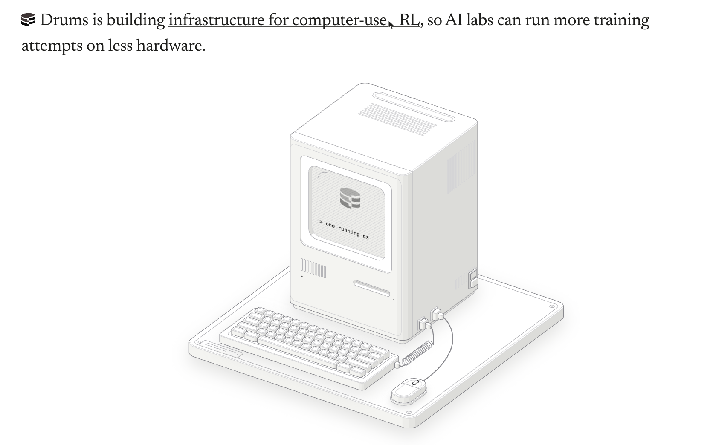

# Drums

Drums is building infrastructure for computer-use RL, so AI labs can run more training attempts on less hardware.

**Where things stand, in one paragraph.** The original plan measured how many isolated computer-use sessions one Mac can run. That
plan was replaced by a Linux-versus-Linux comparison: many attempts sharing one running Linux OS, each in a private box, against the
tuned virtual-machine setups that other projects use. A working local prototype exists (sessions that run the real OSWorld guest
server and a real browser). **Nothing has beaten an incumbent, and nothing has run on a real GPU host.** Three ways of sharing more
than files between sessions were built and measured; each failed something important, and the failures are written up in full.

Every page in `docs/` begins with an **epistemic status** line: BUILT, MEASURED (with the raw data path), PLAN, or
HYPOTHESIS-UNTESTED. Trust the label before the prose.

## Start here

| If you want to know | Read |
|---|---|
| What a Drums session is, what is shared and what is private (with diagrams) | `docs/architecture-overview.md` |
| What has been proven, and what has not | the table below, then `docs/l1-shared-runtime-design.md` |
| How the comparison against a tuned incumbent will be run | `docs/matched-comparison-protocol.md` |
| What it takes to get to a real training smoke on a GPU host | `docs/training-integration-runbook.md` |

## What exists, what is proven, what is only an idea

| Piece | Status | Evidence |
|---|---|---|
| Sessions: namespaces + copy-on-write filesystem + own display + network policy, real OSWorld guest server, real browser | BUILT, runs locally (L0: shares files, not running memory) | `docs/architecture-overview.md`, `docs/osworld-contract-spike.md`, tests in `envd-linux/tests` |
| A real public OSWorld task scored through the real OSWorld code (0.0 before, 1.0 after) | MEASURED, ONE task, hand-written step | `docs/osworld-contract-spike.md` section 8 |
| Cleanup after a crash by ownership records (never by name) | BUILT, tested | `envd-linux/envd_linux/sweep.py`, `docs/osworld-contract-spike.md` section 4 |
| Mechanism F: fork the guest server from a warm template | BUILT prototype, MEASURED, **FAILED** its thresholds (6% memory saving, target 15%) | `docs/mechanism-f-fork-server.md`, `docs/data/l1-prototype/` |
| Mechanism B: one shared browser, each session a profile | BUILT prototype, MEASURED: 54% less memory per session, **FAILED isolation** and changes what the agent sees | `docs/mechanism-b-shared-browser.md`, `docs/data/l1-branch/` |
| Mechanism K: kernel page merging across sessions (+ no address randomisation) | `docs/mechanism-k-page-merging.md`; results in `docs/l1-shared-runtime-design.md` section 13 | MEASURED: K2 saves 41% memory but only with address randomisation OFF (not shippable) and fails the CPU threshold; K1 saves 7% and fails the CPU bar; no K arm is shippable; strong cross-session timing channel (`docs/data/l1-ksm/`) |
| Mechanism C: CRIU checkpoint and restore of a warm session | `docs/mechanism-c-criu-restore.md`; results in `docs/l1-shared-runtime-design.md` sections 15 and 17 | MEASURED: a full session with its browser restores as isolated siblings; with the clone-hygiene reseed it is 1.76x faster than a cold L0 start (below the 2x target; 2.09x without hygiene), memory 1.04x; C3 fails its original wording and passes amended revision 2a; supervisor-crash cleanup demonstrated; no incumbent comparison (`docs/data/l1-criu/`) |
| Branching a real task setup state (LibreOffice launch, via the real SetupController) | `docs/l1-shared-runtime-design.md` sections 18 and 19 | MEASURED: restores 3.6x faster than cold-plus-setup, state preserved and private, memory equal; the saving is about 2 s per rollout (small); one setup, no evaluator, no incumbent comparison (`docs/data/l1-criu/task_branch_probe.json`) |
| Snapshot-API bridge into the matched runner (setup-only reuse and a mid-task branch, the evaluator's shell-getter and string-match path only, with `librosa` stubbed: see `docs/task-audit-13.md`) | `docs/l1-shared-runtime-design.md` sections 20 and 21 | MEASURED on real sessions for one task: reuse and branching preserve task state, siblings diverge under the real evaluator; found and fixed an overlay rename defect, a restore race and a 24 s `sudo` hostname stall; NO incumbent comparison (`docs/data/l1-criu/matched_reuse/`) |
| Matched comparison runner (Drums vs incumbent on the same tasks, valid rollouts per dollar) | BUILT, fake-tested; **never run for real** | `docs/matched-comparison-protocol.md`, `compare/` |
| Host execution package for the first real VirtualBox-incumbent run (fail-closed runner, bootstrap, image fetch, AWS control CLI with teardown) | `docs/aws-incumbent-runbook.md`, `compare/drums_compare/host_run.py`, `awsctl.py`, `deploy/aws_host/` | BUILT and unit-tested with fakes; UNRUN: no AWS credential, no instance, no VM, no spend; no incumbent result exists. Corrected after independent review (`docs/aws-small-stage-plan.md` adds a small stock Docker/KVM cold-reset stage) |
| Training integration (worker entry point, controller on the real agentrl interface, smoke job) | BUILT up to a fake task; the OSWorld task module and everything on a GPU host are gaps | `docs/training-integration-runbook.md` |
| Any win over an incumbent | **NOT PROVEN.** The comparison needs a host with KVM, quota and money: a decision for the owner | `docs/matched-comparison-protocol.md` section 6 |
| Cost figures | HYPOTHESIS-UNTESTED (every price unverified) | `docs/linux-comparison-cost.md` |

## Where the numbers live

| Data | Path |
|---|---|
| Mechanism F (fork) raw results | `docs/data/l1-prototype/` |
| Mechanism B (shared browser) raw results | `docs/data/l1-branch/` |
| Mechanism K (page merging) raw results | `docs/data/l1-ksm/` |
| Mechanism C (CRIU restore) raw results | `docs/data/l1-criu/` |
| Original macOS experiment 1 (nothing measured) | `results/`, `envd/` (the Swift daemon) |

## Repository map

| Path | What it is |
|---|---|
| `docs/` | every design, experiment and decision page; start with `architecture-overview.md` |
| `envd-linux/` | the Linux session machinery (`envd_linux/`), the sharing prototypes (`envd_linux/l1proto/`), the training-driver code (`envd_linux/scalecua/`), and its tests |
| `compare/` | the comparison harness: runner, scorer, matched-comparison runner, task split script, tests |
| `verify-server/` | the independent verifier used by the browser-task tests |
| `envd/` | the original macOS Swift daemon (the protocol reference) |
| `tasks/` | task definitions for the original harness |

## Rules this repository keeps

- Nothing is launched: no cloud resource is created and no credentials are used.
- Levels are labelled: **L0** shares files only; **L1** (shared running runtime) is the real Drums claim and is not proven. An L0 result is
  never described as L1.
- A result is published whether it passes or fails; thresholds are committed before the measurement.
- A mechanism's name is not the contribution. Only a measured increment over a tuned incumbent counts.

## License

Apache-2.0. See `LICENSE`.
