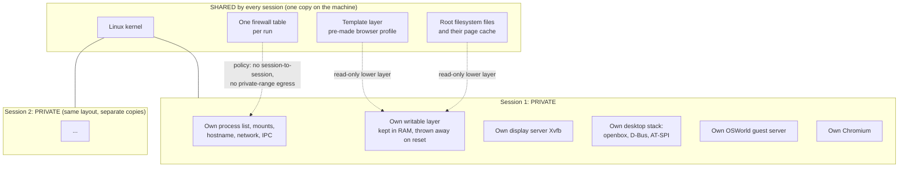
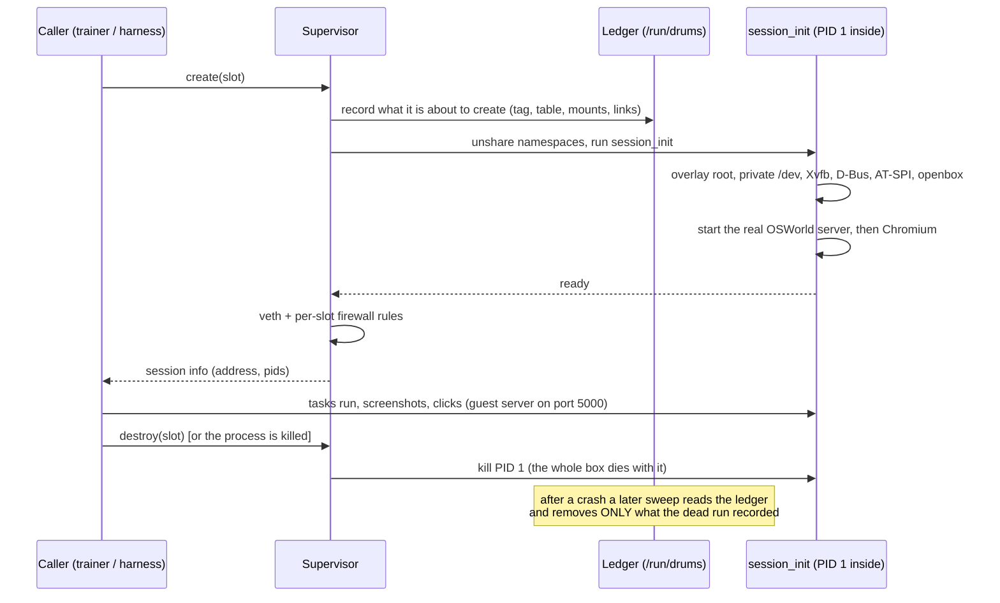

# Architecture overview: what a Drums session is, and what it shares

**Epistemic status: BUILT (the L0 session machinery, local sandbox only) and MEASURED where marked.** The shared-runtime claim
(L1) is NOT built and NOT proven: see section 5 and `l1-shared-runtime-design.md`.

## 1. The idea in plain words

Training a computer-use AI needs many "computers" to practise on at once. The usual way gives each attempt its own virtual
machine: a whole fake computer with its own operating system. That is safe but heavy.

Drums asks a different question: **can many attempts share one running operating system, each in its own private box, so that the
same hardware runs more attempts?** Sharing only counts if two things stay true. The attempts must not be able to see or change each
other, and each attempt must see the same desktop and the same task a normal virtual machine would show it.

## 2. What exists today (L0)

L0 means: one Linux kernel is shared; each session gets private copies of everything else. It is a precursor, not the Drums claim.

**What is shared** is only files on disk (so the same bytes are not stored twice) and the kernel. **What is private** is every
running process and all writable state. That is why L0 saves little memory per session: the running programs are duplicated.

## 3. The life of a session

## 4. Where each thing is documented

| Topic | Page | Status |
|---|---|---|
| The L0 spike (real Chromium task through the daemon) | `envd-linux-spike.md` | BUILT, MEASURED (one sample) |
| OSWorld guest-server contract, real server in sessions, a real public task | `osworld-contract-spike.md` | BUILT, one task MEASURED |
| Network policy and the cleanup sweep | `osworld-contract-spike.md` section 4, `incident-docker-leftovers.md` | BUILT, tested locally |
| systemd as PID 1 in a session | `gnome-namespace-investigation.md` | one run; findings and a host-side-effect incident |
| Sharing mechanism F (fork server) | `mechanism-f-fork-server.md` | BUILT as a prototype, MEASURED: FAILED its thresholds |
| Sharing mechanism B (shared browser) | `mechanism-b-shared-browser.md` | BUILT as a prototype, MEASURED: FAILED isolation |
| Sharing mechanism K (page merging) | `mechanism-k-page-merging.md` | BUILT as a prototype, MEASURED: K2 saves memory only with ASLR off (not shippable) and fails CPU; K1 saves 7% and fails CPU; no K arm shippable; introduces a strong timing channel |
| Sharing mechanism C (CRIU restore of a warm session) | `mechanism-c-criu-restore.md` | BUILT as a feasibility probe, MEASURED: works; 2.09x faster than cold L0 start (1.87x cold cache); no incumbent comparison |
| Per-session resource limits and interference canary | `matched-comparison-protocol.md` section 4a | BUILT (READINESS, not a result) |
| The matched comparison against an incumbent | `matched-comparison-protocol.md` | PRE-REGISTERED; runner BUILT, never run |
| The path to a real training smoke | `training-integration-runbook.md` | PLAN |
| Weights, licences, tasks | `weights-routes.md`, `training-comparison-plan.md` | research notes |
| Cost model | `linux-comparison-cost.md` | HYPOTHESIS-UNTESTED (every price unverified) |

## 5. What is proven, what is not

- PROVEN locally (this sandbox, L0): a session boots in about 1 to 2 seconds, runs the real OSWorld guest server and a real browser,
  keeps its state private, and can be torn down and swept. One real public OSWorld task scored 0.0 before and 1.0 after, through the
  real OSWorld code.
- MEASURED and NEGATIVE: forking the guest server saves 6% of per-session memory (target was 15%); sharing one browser saves memory
  but lets any session read and control its neighbours' pages.
- NOT PROVEN: any L1 claim; any win over a tuned incumbent; the OSWorld image's own desktop (GNOME, systemd); anything on a real GPU
  host; any cost figure.
