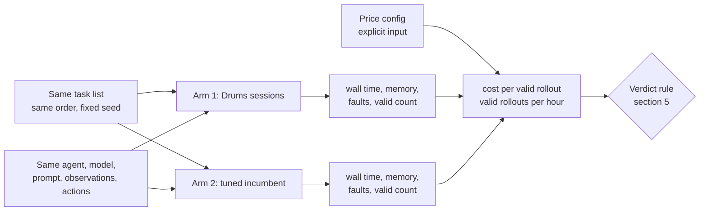
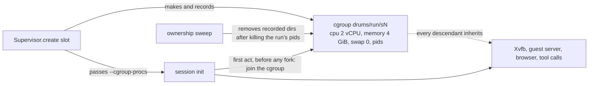

# Matched comparison protocol: Drums versus a tuned incumbent on the same OSWorld tasks

**Epistemic status: PRE-REGISTRATION (written before any run).** The runner is **BUILT** and unit-tested with fake adapters
(`compare/drums_compare/osworld_matched.py`, `compare/tests/test_osworld_matched.py`): that is harness validation. **No real
comparison has been run.** Any dry run of an adapter is harness validation and is never reported as a result. Running it for real
needs a host with KVM, quota and money: a decision for the project owner, not something this repository does by itself.

## 1. What this compares, in plain words

We want to know one thing: **for the same tasks and the same agent, who produces more valid training rollouts per dollar?**

A *rollout* is one attempt by the agent at one task. It is *valid* if the environment did not fail and the evaluator produced a
score. A rollout that fails still costs money, so it counts against the arm that produced it.

## 2. The two arms

| | Arm 1: Drums | Arm 2: incumbent |
|---|---|---|
| Environment API | the public `DesktopEnv` with the Drums provider bridge (`osworld_provider`, region `drums`) | the stock public `DesktopEnv` with the incumbent's own provider |
| Isolation unit | a Linux namespace session sharing one kernel (L0 today; a precursor, not the L1 claim) | a virtual machine (or the provider's own unit) |
| Reuse features that must be ON | a pre-warmed pool of sessions, one per worker, reused across rollouts (a fresh session per rollout, built eagerly) | a pre-warmed pool of environments, one per worker, reused across rollouts; the provider's snapshot revert on reset wherever the public API provides it |
| What the runner touches | `reset`, `step`, `evaluate`, `close` on `DesktopEnv` | the same four calls |

**The tuned baseline, not a strawman.** The incumbent arm must have every reuse feature its public API offers switched on: the pool
is built before the clock-relevant work and reused, and the snapshot named `init_state` is used for the revert on reset when the
provider has one (the public `DesktopEnv.reset` reverts only after an environment has been used; that is the incumbent's own
behaviour and the runner does not change it). The provider and its settings are part of the run specification. If the owner wants the
OSGym-style variant (KVM plus copy-on-write snapshot resume), that is a different adapter against a different public repository and is
**not built**.

**Resource parity (a precondition that is NOT met today).** The incumbent's VMs have fixed vCPU and RAM (the shipped ScaleCUA worker
config uses 2 vCPU and 4 GiB per VM). Drums sessions can now be given per-session cgroup limits (section 4a, BUILT). The limits applied are recorded in each session's
`session.json` (`limits`) and must be copied into the run's `run.json`. Parity still requires that the incumbent arm's VM shape was
actually 2 vCPU / 4 GiB on the host used, and the report must show measured CPU and memory use for both arms.

## 3. Task sampling rule

- Task source: the held-out list from `compare/drums_compare/osworld_split.py` (our split of the public OSWorld tasks, a benchmark of
  our own, not comparable to published headlines).
- Sequence: every task appears `r` times; the order is a seeded shuffle (`sample_tasks`); **both arms receive the identical list**.
- Concurrency and rollouts per task are equal across arms and are part of the run specification.
- If both arms share one host, they run in alternating blocks (A B B A) so that drift hits both; on separate hosts they run at the
  same time.
- Only tasks in the environment tier both arms can run are used (`e1-coverage-matrix`, not committed: the rule is that a task one arm
  cannot run is dropped from both).

## 4. What is measured, and how it is counted

| Quantity | Definition |
|---|---|
| Rollout wall time | from lease acquired to lease released, per rollout (p50 and p95 reported) |
| Reset time | time inside `reset(task_config)` |
| Valid rollout | completed with no adapter fault and a score from the evaluator |
| Faults | counted by kind (`reset_failed`, `step_failed`, `evaluate_failed`, `no_score`, exceptions); an invalid rollout is still paid for |
| Valid rollouts per hour | valid / arm wall hours; **the pool build time is inside the wall time** |
| Cost per valid rollout | `hosts x host_usd_per_hour x wall_hours + fixed_usd`, divided by valid; the prices are a JSON input per arm, never a constant in the code |
| Host memory | used memory (total minus available) sampled once a second; peak and mean; peak delta divided by concurrency |
| Interference | `interference_count` in every arm summary, from the per-slot canary (section 4a). A marker that survives a reset makes that rollout invalid (fault `interference`); leases that cannot run commands are counted as `canary_unsupported`, never as clean |

## 4a. Readiness: resource limits and the interference canary (BUILT, not results)

**Status: BUILT and tested; nothing here is a measurement of Drums against an incumbent.**

- **Resource limits** (`envd-linux/envd_linux/limits.py`, `Supervisor(limits=...)`, default incumbent shape = 2 vCPU, 4 GiB, no swap, 4096
  pids). The session's own init joins the cgroup as its first act, so there is no window in which a child runs outside it. The cgroup dirs are
  written to the sweep ledger before they exist and removed by `close()` and by the sweep. Tested: backend file writes against fake v2 and v1
  hierarchies (form only), and a real session on this host that joins its cgroup, has Xvfb inside it, reads the limits back, and leaves nothing
  behind. **Declared gaps:** this development host is cgroup v1/hybrid, so the real-session test exercises the v1 backend; the v2 backend (what
  a modern AWS host uses) has never run against a real v2 kernel here. Throttling and out-of-memory behaviour under the limits was not measured.
  Whether the incumbent's VMs are actually 2 vCPU / 4 GiB on the run host is for the run spec to verify.
- **Interference canary** (`osworld_matched.run_arm(canary=True)`, default on). After each reset the runner reads every marker present in the slot
  (`/tmp/.drums_canary` and `~/.drums_canary`, over the public `DesktopEnv.controller.run_bash_script`), then writes its own. A marker found
  after a reset is state that survived the revert: the rollout is invalid with fault `interference`, counted, and still paid for. The first rollout
  on a slot cannot see anything by construction. The check covers two file locations only; it does not look for leaked processes, browser state or
  clipboard. Tested with fake adapters that reset cleanly and that leak, a failing probe (a fault, never a pass), and the controller path, AND exercised in the real-session dry run (`test_osworld_matched_dryrun.py`): 4 of 4 rollouts probed clean on real Drums sessions, with a positive control (a written marker is seen by the probe; a Drums reset removes it). The incumbent adapter's canary has run against fakes only.

## 5. Verdict rule (fixed now)

The ratio is *valid rollouts per dollar of Drums divided by the same quantity for the incumbent*, with a 95% bootstrap interval over
rollouts (`compare()`).

- **WIN** only if all of these hold: the interval's lower bound is above 1.0; the isolation audit passes (no cross-session leak found
  by the audits in the design docs, including the checks that failed for mechanism B); an equivalence pilot shows the same evaluator
  semantics on both arms for scripted action sequences; and the run is at least 3 alternating blocks.
- **MEANINGFUL WIN** additionally needs the point ratio at least 1.25.
- Anything else is reported as **TIE** or **LOSS** with the same prominence, with the raw rows.

## 6. Expected outcome, stated in advance so it can lose

I expect the current Drums arm (L0: shared files, private everything else) to **tie or lose** against a properly tuned incumbent on this
workload. L0 removes the guest kernel and boot but keeps one full application stack per session, and the section 9 and 10 measurements
in `l1-shared-runtime-design.md` show that the memory that matters is the browser and desktop stack, which L0 duplicates. A win needs a
mechanism that shares that memory without weakening isolation or changing what the task sees; none of the mechanisms measured so far
does both.

## 7. Dry runs

A dry run of the `DesktopEnv` adapters against a fake `DesktopEnv` (in `test_osworld_matched.py`) validates the plumbing only. A run of
the Drums adapter against a real local session with a scripted agent is also harness validation. Neither is a result, and neither
may be quoted as one.
