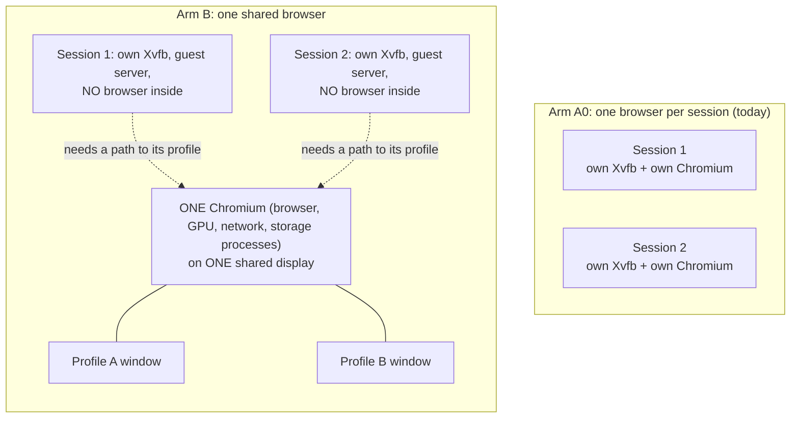
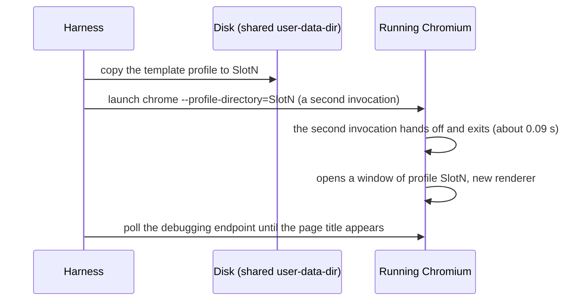
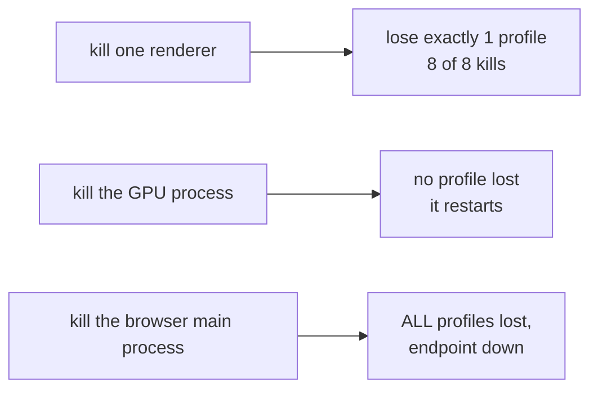

# Mechanism B: one shared browser, each session a profile inside it

**Epistemic status: BUILT (prototype) and MEASURED. Result: big memory and latency wins, but it FAILED the isolation check and it
changes what the agent sees.** Raw data: `docs/data/l1-branch/` (`bench.json`, `isolation.json`). Thresholds were committed first
(`d116f92`). Full tables: sections 10 and 11 of `l1-shared-runtime-design.md`.

**Prior art note.** Running several browser profiles inside one browser is ordinary Chromium behaviour. The label is not the
contribution. It matters here only as a measurement: how much memory a shared browser would save, and what that costs in isolation.

## 1. The idea in plain words

Today every session starts its own browser, and a browser is about ten processes. Twenty sessions mean two hundred browser processes
doing mostly the same startup work. Mechanism B starts **one** browser for the whole machine. Each session gets its own *profile*
(cookies, storage, cache, saved settings) inside that browser and its own window.

## 2. Arms and boundaries



## 3. Shared versus private, honestly

```mermaid
flowchart LR
    subgraph SHARED["SHARED by every session in arm B"]
        P1[Browser main process]
        P2[GPU process]
        P3[Network service<br/>(sockets, DNS)]
        P4[Storage service]
        P5[The debugging endpoint<br/>(one port for every window)]
        P6[One display]
    end
    subgraph PRIVATE["PRIVATE per session in arm B"]
        R1[Profile directory:<br/>cookies, storage, cache]
        R2[Renderer process for its window]
        R3[Session's own namespaces,<br/>guest server, Xvfb]
    end
```

## 4. How a profile is attached



## 5. What was measured

| Check (threshold fixed in advance) | Result | Verdict |
|---|---|---|
| Memory per additional session: B at most 0.80 of A0 | A0 229.8, B 104.6 MiB (ratio 0.455); 20 sessions: 4596 vs 2281 MiB total; fixed cost 175 MiB | **PASS** |
| Ready latency: B p95 below A0 p95 and B median at most 0.7 of A0 | A0 0.320 / 0.380 s, B 0.205 / 0.233 s | **PASS** |
| Storage isolation: cookies, localStorage, IndexedDB, cache, 20 profiles | zero foreign observations; zero cross-profile cache hits | **PASS** |
| Targets and routing: 20 distinct; 60 of 60 concurrent attaches in the right profile | 20 distinct, 59 of 60 right (one failed verification, cause undiagnosed) | **FAIL** (by one) |
| Exposure through shared channels: any cross-profile path is a leak | a session with a path to the debugging endpoint can list, read and run script in every sibling window | **FAIL** |
| The session's own screenshot | unchanged by the attach: the browser is not in it | reported |

## 6. What a session can learn or do to its neighbours (the leak, in detail)

As built, the debugging port listened on 127.0.0.1 only, so a session in its own network namespace could not reach it. That is an
accident, because every real design needs the session to reach *its own* profile. With the simplest bridge, a session could:

- see the titles and addresses of all 21 windows, including other sessions';
- read a secret held only in a sibling's page memory;
- run script in a sibling's page (it changed the sibling's title; the host saw it);
- read process information for the whole browser.

Cookies and storage themselves stayed separate. The weakness is the **control channel**, not the storage. A per-session filtering
proxy could narrow it; it was not built, and a filter would then have to be audited too.

## 7. Blast radius



## 8. Why it cannot be the path, and what it taught

- **Isolation:** the unit became a profile, weaker than a process, and the shared debugging endpoint breaks it (section 6).
- **Semantics:** a shared browser cannot draw into each session's own display, so the session's screenshot no longer shows the
  browser, and browser files are outside the session's filesystem. Substituting browser-level screenshots is not equivalent to the
  real desktop the OSWorld tasks expect.
- **What it proved:** about **125 MiB per session is duplicated browser state**. That is the size of the prize for any mechanism that
  keeps one browser process per session. That reasoning led to the page-merging experiment (`l1-shared-runtime-design.md` section 12).

## 9. Not tested

Per-session filtering of the debugging endpoint; whether the one failed concurrent attach is a race or a test artifact; downloads and
file-dialog behaviour; any real OSWorld task through the shared browser; GPU-enabled browsers.
