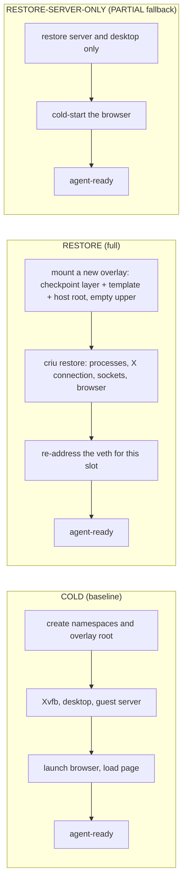
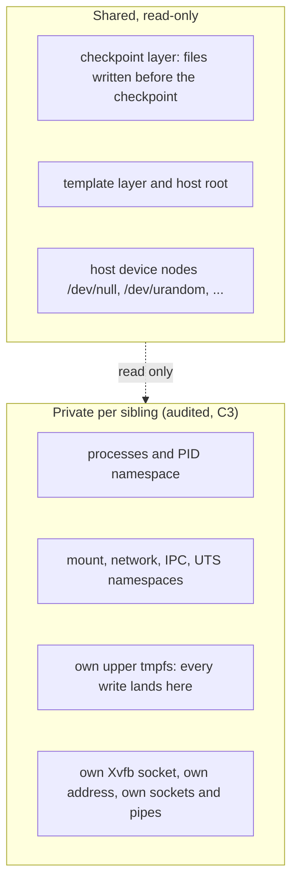

# Mechanism C: CRIU checkpoint and restore of a warm session

**Status: BUILT as a feasibility probe. MEASURED on one host (raw data: `docs/data/l1-criu/`). Verdict: it works, and the usable version (with the clone-hygiene reseed) is
1.76x faster than a cold L0 start (interval 1.73 to 1.83), BELOW the registered 2x target; without the reseed it was 2.09x, but a restore that skips hygiene is not usable. Memory with the reseed is 1.04x of cold
(4% MORE). C3 fails its original wording on two shared host device nodes and passes the amended revision 2a; supervisor-crash cleanup is demonstrated. No increment over any incumbent was measured.** Pre-registration: `l1-shared-runtime-design.md` section 14
(commit `8f5ed06`). Results: section 15. `drums_level` stays L0. A fast restore is prior-art territory (VM snapshot resume).

## The idea in plain English

Starting a session from scratch means starting a window system, a desktop, a server and a browser, and loading a page. Instead, start one session
once, let it reach exactly the state an agent should see, freeze it to disk (CRIU, "checkpoint/restore in userspace"), and later thaw copies of it. Each copy is
its own set of processes with its own private files, so the design intent is that isolation and the screenshot an agent sees are the same as for a cold session.
That is an intent: it holds only to the extent the measured sharing audit (C3) shows nothing is shared between copies.

## Arms



## Lifecycle

```mermaid
sequenceDiagram
  participant Sup as Supervisor
  participant Cold as cold session
  participant CRIU as criu (private install)
  participant Sib as restored sibling
  Sup->>Cold: create (criu_friendly): browser up, page loaded
  Sup->>CRIU: dump -t init (processes die; one-time, offline)
  Sup->>Sup: keep the session's overlay upper tmpfs as the read-only checkpoint layer
  loop each sibling
    Sup->>Sup: ledger the mounts, link and veth, then mount a fresh overlay
    Sup->>CRIU: restore --root <overlay> with external veth, X11 dir, device nodes
    CRIU->>Sib: processes resume
    Sup->>Sib: re-address the veth, wait for the guest server
  end
```

## What is shared and what is private



## Results (MEASURED; scored in `l1-shared-runtime-design.md` section 15)

| | COLD | RESTORE (full) | RESTORE-SERVER-ONLY (PARTIAL) |
|---|---|---|---|
| time to agent-ready, p50 / p95 | 2.05 / 2.19 s | 0.98 / 1.22 s | 1.22 / 1.28 s |
| ratio to COLD (p50) | | 2.09x (1.99 to 2.15) | 1.68x |
| same, page cache dropped (NOT pre-registered) | 2.59 s | 1.38 s (1.87x) | 1.67 s (1.55x) |
| host memory per added session | 229.4 MiB | 221.9 MiB (0.967x) | not measured |

- **Correctness:** C1 PASS (public task 0.0 then 1.0 through the real evaluator, from restored sessions), C2 PASS (99.7% of pixels differ from a blank desktop; browser title present), C3 FAIL by its literal wording and PASS
  against a cold-pair control (the only shared writable objects are two host device nodes that cold sessions share too).
- **The server-only arm is PARTIAL:** the browser stays cold, so it is not the mechanism. It missed the 2x target.
- **What it took:** CRIU 4.2 (4.1.1 cannot read TCP socket options on kernel 6.18); a session whose fds and mappings all lie inside its own root; the kill-on-parent-exit signal disabled; the
  overlay upper kept on a host-visible tmpfs. Full list and the CRIU flags in section 15.

## Follow-up: hygiene, crash cleanup, amended audit (section 17 of the design doc)

- **Clone hygiene is built:** hostname, the guest server's Python `random`, and (for a checkpoint DECLARED CLEAN only) the browser's cookies and a fresh renderer. A checkpoint not declared clean keeps its browser state, because erasing a real task's cookies would change the task. Residuals: Python's string-hash seed and the address-space layout stay identical across clones.
- **With the reseed:** restore p50 1.19 s vs cold 2.10 s = **1.76x (FAIL of the 2x target)**; memory 238.3 vs 229.6 MiB per session (1.04x, passes the 1.05x threshold, but costs more than cold).
- **Crash cleanup:** killing the supervisor with restored sessions live leaves them running (friendly mode removed the kernel's kill), and the ownership sweep then reaps all of it (processes, 7 mounts, links, table) while sparing a decoy. Works for the run that made the checkpoint only.
- **C3 under revision 2a** (exactly `/dev/null` and `/dev/urandom`, with the cold control): PASS; under the original wording: FAIL, kept.

## Honest limits

No incumbent comparison (no KVM). The saving is about 1.07 s per start, so the effect on valid rollouts per hour is about that over the rollout length (1.8% for 60 s, 0.2% for 600 s), which is
arithmetic, not a measurement. Restored copies are clones (same random-number state, tokens, profile, hostname): effect on rollouts untested. Images are kernel- and CPU-specific; restore on a second host untested; a
checkpoint cannot yet be reused across supervisor runs. `--no-sandbox` Chromium only, no GPU, one task, one checkpoint.

## Reproduce

```
PYTHONPATH=<OSWorld checkout>:envd-linux:compare DRUMS_CRIU_HOME=<private criu dir> \
  <osw venv python> -m envd_linux.l1proto.criu_probe --out probe.json --task <e0df059f.json> --starts 20 --trials 3
```
`DRUMS_CRIU_HOME` holds `x-4.2/usr/sbin/criu` and `libs/{bin,usr/lib/x86_64-linux-gnu,lib/x86_64-linux-gnu}`; nothing is installed system-wide. Needs root.
