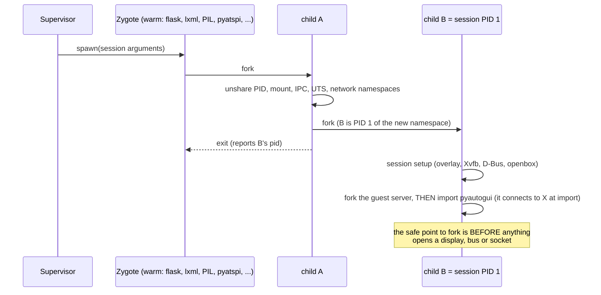
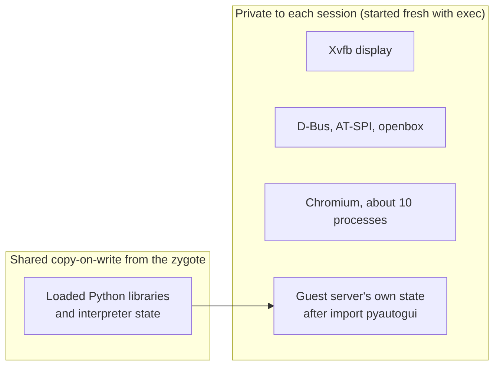

# Mechanism F: fork the guest server from a warmed template

**Epistemic status: BUILT (prototype) and MEASURED. Result: it FAILED its pre-registered memory and latency thresholds.** Raw data:
`docs/data/l1-prototype/` (`bench.json`, `hazard.jsonl`, `hygiene.json`). Thresholds were committed first (`84a9241`); the full
tables are in section 9 of `l1-shared-runtime-design.md`. This page is the readable version.

**Prior art note.** Fork servers ("zygotes") are an old technique (Android, Chromium's renderers). The label is not the
contribution. The only thing that would count is a measured increment over a tuned incumbent; this mechanism does not provide one.

## 1. The idea in plain words

Starting a Python program is slow partly because it must load many libraries first. A *zygote* is a program that loads them once and
then makes copies of itself on request. A copy starts fast and, until it changes something, shares the loaded memory with the
original. We applied this to the OSWorld guest server (a Python web program that runs inside each session).

## 2. How it was built

## 3. Shared versus private

Only the Python part is shared. **Chromium is started fresh in every session**, because a browser with live display and bus
connections cannot be copied (shown below).

## 4. What was measured

20 sessions per arm for latency, 4 trials of 20 concurrent sessions per arm for memory, one 4-CPU sandbox. Arms: **C0** the server as
OSWorld ships it, **C1** a fresh interpreter with the same entry point as F, **F** the fork.

| Check (threshold fixed in advance) | Result | Verdict |
|---|---|---|
| Memory per additional session: F at most 0.85 of C1 | C1 231.1, F 216.8 MiB: ratio 0.938 (interval of the difference 13.1 to 15.5 MiB, excludes 0) | **FAIL** (6.2% saving, not 15%) |
| Server ready: F p95 below C1 p95 and F median at most 0.7 of C1 | p95 0.93 vs 1.17 s passes; median 0.86 vs 1.08 s is 0.80 | **FAIL** (median condition) |
| Chromium ready: F p95 below C1 p95 | 1.33 vs 1.53 s | PASS (all of it from the server part) |
| Sibling hygiene | separate PID, mount and network namespaces; one Xvfb each; no leaked descriptors; independent random draws | PASS |

**Why it could not do better** (share bound): the part fork can reach is about 51 MiB of the 231 MiB per-session host cost, at most 22%
even if all of it were shared. Chromium, the biggest piece, is exec'd.

## 5. What breaks if you fork a server that is already running

A separate hazard test forked a live server holding an X connection, a D-Bus connection, a listening socket and a locked thread:

| Shared thing | What happened |
|---|---|
| X display | the child saw the parent's window: there is no isolation, both are clients of one display |
| X connection | both copies hung: replies got consumed by the wrong process |
| Listening socket | the child took all 100 connections: no routing to "its" session |
| D-Bus | same unique name in both; the child's call timed out after 3.0 s |
| Lock held by another thread | stayed locked forever in the child |

So fork is safe only **before** a process opens such state, which limits how much can be pre-loaded.

## 6. Verdict

Mechanism F works and is clean, and it is too small to matter: **it is not a path to winning the comparison.** The honest
use of this result is the share bound: it showed that the memory worth attacking is the browser and the desktop stack, which led to
the later experiments.
