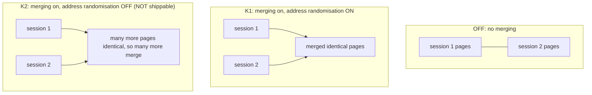
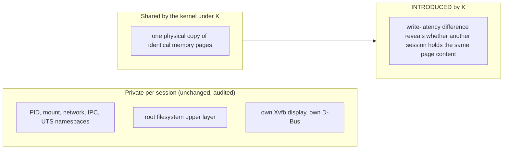

# Mechanism K: kernel page merging across sessions

**Status: BUILT as a prototype. MEASURED on one host (raw data: `docs/data/l1-ksm/`). Verdict: no arm is a product mechanism. K2 is benchmark-sandbox
only, a security regression, not shippable.** Pre-registration: `l1-shared-runtime-design.md` section 12 (commit `8062ff0`). Results: section 13.
`drums_level` stays L0; this is not an L1 proof, and it makes no claim against any incumbent (their VMs can use page merging too).

## The idea in plain English

Twenty sessions each run the same desktop software, so many 4 KiB pages of memory hold identical bytes. Linux can notice that and keep one
copy for all of them (kernel same-page merging, "KSM"); a session that later writes to a shared page gets its own private copy. Nothing about the
sessions' processes, files or displays changes: it is a memory-accounting trick under them. The catch: it only finds identical pages, and by
default each process's memory is laid out at randomised addresses, so pages that contain pointers differ between sessions and do not merge.

## Arms



## What is shared and what stays private



## Lifecycle of a K session

```mermaid
sequenceDiagram
  participant Sup as Supervisor
  participant Host as host sysfs (ledgered, restored on close)
  participant Init as session init
  participant Kern as kernel ksmd
  Sup->>Host: run=1, pages_to_scan=20000, sleep_millisecs=2, use_zero_pages=1 (priors recorded first)
  Sup->>Init: spawn with --ksm (K1) or --ksm --no-aslr (K2)
  Init->>Init: personality(ADDR_NO_RANDOMIZE) if K2; prctl(PR_SET_MEMORY_MERGE)
  Note over Init: both flags are inherited across fork and exec
  Init->>Init: start Xvfb, guest server, browser
  Kern->>Kern: scan, find identical pages across sessions, merge them
  Sup->>Host: close(): restore the prior knob values
```

## Results (MEASURED; scored in `l1-shared-runtime-design.md` section 13)

| | OFF | K1 | K2 |
|---|---|---|---|
| host memory per added session | 229.7 MiB | 212.7 MiB (-7%) | 135.4 MiB (-41%) |
| merging-thread CPU (vCPU, threshold 0.25) | 0 | 0.90 | 0.71 |
| M-K1 / M-K2 verdict | | FAIL / FAIL | PASS / FAIL |

- **K2 is benchmark-sandbox only: a security regression, not shippable.** Switching address randomisation off in every process of the session
  makes any memory-corruption bug in the browser, the office suite, the guest server or the agent's own commands much easier to exploit, because every
  address is the same each run. The saving exists only because of that.
- **K introduces a real cross-session timing channel.** Two probes in two sessions: both held 8192 merged pages; a classifier on first-write latency, fitted
  on half the pages and scored on the other half, reached 99.9% accuracy at roughly 200 yes/no answers per second (upper bound for a cooperating probe with known
  page content). What was inferred is whether a page with a KNOWN content also exists in another session. It does not read memory and does not find
  content the prober cannot guess.
- **Audit scope (declared boundary).** The semantics and isolation audit (M-K3) ran against K2 only and covers process, mount, network and display
  isolation; the timing channel is outside it and was measured separately.
- First M-K5 attempt was invalid (a shared mapping that KSM cannot merge); recorded in section 13, re-run is the data.

## Honest limits

One host and kernel, 3 trials; intervals are over trials. The 0.25 vCPU threshold was fixed before measuring and the scan settings were not re-tuned. Page
merging is incumbent-available prior art, so a "page merging" label is not a contribution; only a measured increment over the tuned incumbent counts,
and this milestone measured none.

## Reproduce

```
python -m envd_linux.l1proto.ksm_bench --out ksm_bench.json --trials 3 --max-n 20 [--limits]
python -m envd_linux.l1proto.ksm_semantics --out ksm_semantics.json --osw-python <venv python> --osw-src <OSWorld checkout>
python -m envd_linux.l1proto.ksm_sidechannel --out ksm_sidechannel.json
```
Needs root and a writable `/sys/kernel/mm/ksm`; the host knobs are restored afterwards (checked: run=0, pages_to_scan=100, sleep_millisecs=20, use_zero_pages=0).
