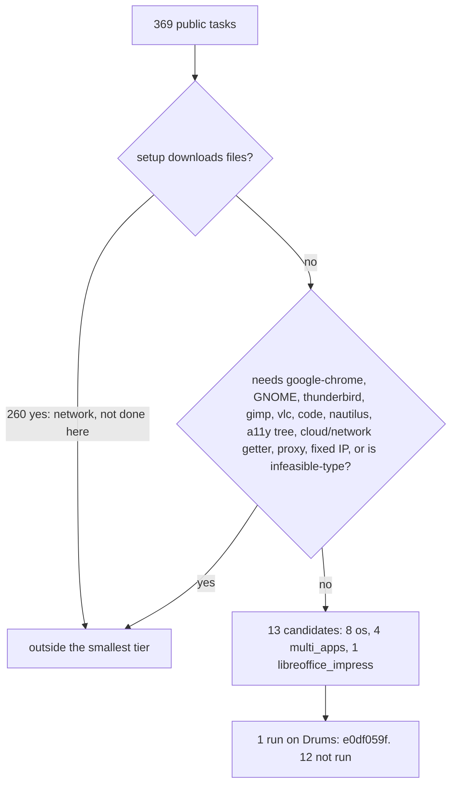

# Task-setup coverage for the Drums arm: the smallest local tier (static dependency report)

**CORRECTION (see `docs/task-audit-13.md`): the 13 "candidates" were a coarse filter. A read-only audit found 1 unchanged, 1 conditional (`2cd43775`, needs a HOME or path alignment) and 11 blocked; "no known blocker" below never meant compatible.**

**Status: MEASURED from files (`docs/data/l1-criu/task_coverage/task_coverage.json`, generated by `envd-linux/envd_linux/l1proto/task_coverage.py`, test `tests/test_task_coverage.py`). It runs nothing, installs nothing, downloads nothing. It is a heuristic classifier of the public task JSON (OSWorld commit `04718ea`, 369 tasks) against what this host's rootfs actually has (`which`). Candidate = "no known blocker found", NOT "runs on Drums". Only task `e0df059f` has been run on Drums.**

## Reasons a task falls out (a task can have several; counts overlap)

| Reason | Tasks |
|---|---|
| setup downloads files (all from huggingface.co: 458 files) | 260 |
| evaluator getter needs the network or cloud | 182 |
| launches `google-chrome` (the Drums rootfs has Playwright Chromium only) | 79 |
| task asks for a proxy | 56 |
| browser or login setup step | 55 |
| evaluator reads Chrome state (debug port, profile, tabs) | 41 |
| GNOME-dependent step or getter (the Drums arm runs openbox) | 28 |
| launches `code` / `thunderbird` / `gimp` / `vlc` / `nautilus` (all absent from the rootfs) | 28 / 25 / 23 / 20 / 11 |
| infeasible-type evaluator (scored on the agent's FAIL action) | 26 |
| evaluator uses the accessibility tree | 15 |
| task asks for a fixed IP | 8 |

## What this means

* **The smallest local tier is 13 of 369 tasks (3.5%)**, and it is almost all the `os` domain plus a few `multi_apps` shell tasks. LibreOffice, Chrome, GIMP, VLC, Thunderbird and VS Code tasks are outside it, mostly because their setup downloads files. Any statement about "OSWorld" from this build is a statement about at most these 13 tasks, and so far one.
* **Known unsupported on the Drums arm today:** `google-chrome` (and so the 79 tasks with a `socat` helper), GNOME, Thunderbird, GIMP, VLC, VS Code, Nautilus, and the accessibility tree for LibreOffice (the `gen` VCL plugin; the runs here set `require_a11y_tree=False`).
* **Needs a download or install to widen the tier, not done:** the 260 setup downloads (needs network access to Hugging Face, and the dataset licence is unresolved), and the application installs above. Any of these is an owner-authorized step, so none was taken.
* **Not checked:** whether each evaluator function's Python dependencies import in the OSWorld environment (only e0df059f's evaluator has run), and whether the heuristic keeps or drops each task correctly. The report lists per-task reasons so each decision can be read.
* **Incumbent side:** the same table applies to the incumbent VM only as far as its image has these applications; that is unverified until an image exists.

Raw rows: `task_coverage.json` (`rows[]`: setup types, launch apps, evaluator functions and getters, reasons).
