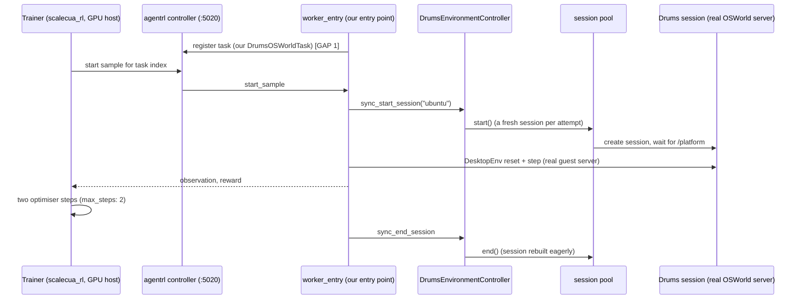

# Training integration runbook: current code to the two-step trainer smoke on a real GPU host

**Epistemic status: PLAN with the gaps named (HYPOTHESIS-UNTESTED beyond the rows marked DONE).** Nothing here has run on a GPU host.
A step list with the gaps named. Nothing here launches anything, uses a credential, or approves spend. Every gap has one
line: what it is, its owner class, and the cheapest way to close it. A step that is done says so with the commit.

Owner classes: **code** (we write it), **GPU quota** (needs a quota or instance the account does not have yet), **grant**
(needs written permission or a licence resolved), **user decision** (the project owner picks).

Claim level for everything below: the sessions are L0 (see `l1-shared-runtime-design.md`); the Drums-vs-baseline comparison
it enables is engineering validation until the evaluation rules in `linux-comparison-design.md` are met. The trainer smoke is
labelled ENGINEERING VALIDATION with an uncertain outcome, never a result.

## 0. The path in one picture

Plain words: the trainer asks the controller for a task attempt. Our worker starts a fresh Drums session, runs the task through
the real OSWorld environment code inside it, and sends back what the model saw and the score. The trainer repeats this for a
batch, updates the model, and does that twice for the smoke. The boxes marked GAP are the parts not written yet.

## A. What is already done locally

| Step | State | Commit |
|---|---|---|
| Drums `EnvironmentController`/`Delegation` on the real `agentrl-worker` 0.4.0 interface (async, sync wrappers, pool, per-attempt rebuild, fault accounting) | DONE, tested against the real package | `bc0cadb` |
| The same interface against the copy the trainer itself installs (`scalecua_rl/worker`, MIT, Z.ai) | DONE: the controller, delegation and `__init__` signatures are identical to 0.4.0 (the only difference is extra optional k8s fields: `labels`, `tolerations`, `node_selector`), and our 3 real-interface tests plus the 15 controller tests PASS with that copy first on the import path (18 passed). The worker entry-point test was not re-run against it | the commit that adds this runbook |
| Worker entry point that installs the "drums" driver before the worker imports `create_controller` | DONE (fake task only) | `0bdb7d7` |
| Bounded validation job (`scalecua.smoke`): wall cap, SIGTERM, teardown, JSON out, sweep before and after; builds its controller through the trainer's path (`create_controller('drums')` after `install()`), and with `--real-kit` also checks the real server's accessibility route and real pyautogui | DONE | `bc0cadb`, `4cf869b`, and the commit that adds this runbook |
| Outer sweep by ownership records, wired into Supervisor start and the smoke job | DONE locally | `4cf869b`, `fe700dc` |
| Session network: per-run nftables table, NAT, session-to-session policy, no metadata/private egress | DONE locally | `098613c` |
| Bridge to OSWorld's `DesktopEnv` provider API, run against the real `desktop_env` (PyPI 1.0.2 and main) | DONE | `098613c`, `bd01ec8` |
| Real OSWorld guest server in sessions: real accessibility tree, real `/terminal`, real pyautogui | DONE (this sandbox's Ubuntu, one app: gnome-terminal) | `e980c46` |
| One public task through real `desktop_env` setup, step and evaluate (0.0 then 1.0), hand-written step | DONE, ONE task | `e980c46` |
| Licensed train/held-out split of the public OSWorld tasks, with its costs stated | DONE as a specification and script | `bd01ec8` |
| Kit license notices and provenance manifest | DONE | `d11fefa` |
| Matched-comparison runner and protocol (fake-adapter tested; never run for real) | DONE as harness validation | the commit that adds this runbook |

## B. Step list and gaps

Each step is a precondition for the next. "Gap" rows are the only open work.

### B1. Bring the environment side to a state the trainer can drive

| # | Step | Status / gap | Owner | Cheapest way to close |
|---|---|---|---|---|
| 1 | A task module for the agentrl worker: implements the agentrl `Task` interface (the MIT `examples/simple-calculator/task.py` shows its shape), creates a Drums session through our controller, wraps it in the real `DesktopEnv` through `osworld_provider`, resets with a public task JSON, executes the model's action, returns an observation, and scores with the real evaluator. It must be written from the MIT agentrl interface and the public OSWorld API only; ScaleCUA's `osworld_env` task code is licence-unresolved and must not be read or copied | GAP. The worker entry point has only ever run a fake task. | code | Write `DrumsOSWorldTask` following `simple-calculator`; test it with the local fake model loop first (our harness), then against the real worker |
| 2 | Model-output parsing: the trainer's model emits text; something must turn it into pyautogui code. ScaleCUA ships its agent for this in `osworld_eval/mm_agents/scalecua-osworld` (Apache-2.0 per the owner-verified ledger) | GAP: not read or tested here. Whether it can be reused unchanged by our task module is unknown | code | Read that agent (Apache-2.0), reuse its parser from our task module; test with canned model outputs |
| 3 | Task registry: the controller knows task names and indices; the training task is `osworld-rl` in ScaleCUA's config, backed by the gated pool. Ours must serve the licensed split | GAP | code | Our task module reads `osworld_split` output (211 train tasks at seed 0) and exposes indices; train and held-out lists never mixed (hash recorded) |
| 4 | An application-complete guest: the OSWorld tasks need LibreOffice, Chrome, VLC, GIMP, Thunderbird and VS Code. The session root is the host's own rootfs, which has none of them | GAP. Without them the public tasks that can run are the 8 app-free ones | code | Build the template layer by installing the OSWorld app set into the lower rootfs on the GPU host (apt), then re-run the coverage classification in `osworld-contract-spike.md` section 8 to count what becomes runnable. The OSWorld VM image itself (`xlangai/ubuntu_osworld`) has an unchecked licence and is not used |
| 5 | Task assets: 271 of the 361 tasks download files in setup; reference files for 202 come from the cloud. They need guest egress (built) and the hosted files | GAP: licence of the asset datasets (`xlangai/ubuntu_osworld_file_cache`) not checked | grant (licence check first) | Check the dataset licences; if clear, pre-fetch on the host and let the guest reach them through the NAT |
| 6 | Real-host prerequisites: root (a VM, not a container), overlayfs, pivot_root, devpts mount, nft, `CAP_NET_ADMIN`, python-xlib, pyroute2, the kit's apt packages, Python 3.12 for `gi` | GAP: only verified in this sandbox | code | A `host-check` script that tests each capability and prints the missing ones; run it first on any new host |
| 7 | Docker or another firewall with a FORWARD DROP policy on the host overrides our accept rule (observed) | GAP | code | `host-check` reads the FORWARD policy and the sweep/launcher adds an explicit session-subnet allow, or the runbook says to stop Docker |
| 8 | Infrastructure smoke: `scalecua.smoke --real-kit ...` with the app layer, several attempts, sweep before and after | PARTLY DONE: the path matches the trainer's; run locally with the stub and the real kit, not with the app layer | code | Run it on the GPU host once step 4 exists |

### B2. Bring the trainer side up

| # | Step | Status / gap | Owner | Cheapest way to close |
|---|---|---|---|---|
| 9 | The agentrl controller (Go): build `scalecua_rl/controller` (MIT) or use a release binary | GAP: Go and `protoc` >= 27 needed | code | Build on a CPU box once; it listens on :5020 |
| 10 | Trainer install: `scalecua_rl/requirements.txt` plus `pip install --no-deps -e ./trainer -e ./worker -e ./eval`; CUDA-pinned torch, vllm, flash-attn, sglang, megatron-core, transformer-engine, ms-swift. The README says to use its validated Docker image; `scalecua_rl/extra/docker/training-base` is the recipe | GAP: nothing installed or built here; the image's CUDA/driver requirements are unchecked against any instance type | GPU quota | Build `training-base` on the GPU node, or the closest published CUDA image; record the versions that import cleanly |
| 11 | Start the worker with our entry point: `python -m envd_linux.scalecua.worker_entry <task> --config <yaml> --controller http://HOST:5020/api`; check `curl .../get_indices?name=<task>` is non-empty | GAP: depends on 1 | code | After step 1, run against the controller on one machine |
| 12 | Evaluation-only dry run with `examples/training/eval_only.py` (rollouts, no optimiser) on 1 to 2 tasks and the fake-then-real model | GAP | code | Same host as 11; this is the first time model, controller, worker and Drums sessions all meet |
| 13 | Start-policy weights: the ScaleCUA SFT checkpoint (research-wording grant unresolved) or the Apache-2.0 base plus our own data (`weights-routes.md`) | GAP: the choice and, for route (i), the grant | grant / user decision | Owner picks a route; for the smoke only, any Apache-2.0 base model loads the trainer even if the policy is poor, so the smoke can run without the grant (it then proves plumbing, not learning) |
| 14 | Smoke config: copy `qw3vl_train_std.yaml`; set `max_steps: 2`, small `train.batch_size`/`n`/`concurrency`, `sampling.method: uniform` (no `initial_pass_rate_file` is packaged and the README allows disabling dynamic sampling for a smoke), `val_before_train: False`, `task.base_url`, `task.train_tasks` | GAP (config only) | code | Edit the copy; keep the rollout `tp_size` and actor `tensor_model_parallel_size` at 2 until the footprint is known |
| 15 | Minimum GPU footprint for the two-step run: unknown. The shipped recipe is TP 2 rollout plus Megatron TP 2 actor; the smoke decides what fits | GAP | GPU quota | Ask for the smallest node that plausibly fits (4 GPUs of 80 GB class); step up only if the smoke OOMs |
| 16 | Two optimiser steps: `bash scripts/run-qwen3vl-train.sh` with `CONFIG_FILE` pointing at the smoke config | GAP: depends on 1 to 15 | GPU quota | Run once, bounded by the wall cap; collect the step times and rollout failure counts |

### B3. Money, termination, teardown

| # | Step | Status / gap | Owner | Cheapest way to close |
|---|---|---|---|---|
| 17 | Verified hourly price for the chosen node and a budget cap | GAP: every price in `linux-comparison-cost.md` is unverified | user decision | The owner grounds prices independently and approves a ceiling; nothing is launched before that |
| 18 | GPU instance quota (the default On-Demand quota for GPU families is 0) | GAP | GPU quota | Quota request for the chosen family and region |
| 19 | Independent termination layer (AWS only): a timer outside the job that terminates the instance whatever the job does | GAP, unbuilt: `smoke.py` documents it as out of scope for the code | code + user decision | Instance-initiated-shutdown-behaviour set to terminate plus a `shutdown -h +N` timer set at launch, and a billing alarm; no credentials are used until approved |
| 20 | Job-level teardown | DONE locally: inner teardown plus outer sweep (`4cf869b`); not exercised on a real host | code | Run the sweep tests and the smoke on the real host as part of step 8 |
| 21 | The sweep does not track cgroup directories (only matters for the systemd experiment, not the current session type) | GAP, follow-up | code | Add cgroup paths to the ledger when a systemd session type is built |

## C. What the sharing experiments mean for this plan

The smoke and the training run use the CURRENT session type (L0). The L1 experiments (`l1-shared-runtime-design.md`) did not
produce a mechanism that is ready to carry a training run: mechanism F failed its memory and latency thresholds, and mechanism B failed
its isolation check and changes what the agent observes. Nothing in this runbook depends on them.

## D. The cheapest order

1. Steps 1 to 3 and 6 to 7 (all code, no spend): a task module, the parser reuse, the registry, a host check.
2. Step 4 on any Linux box (not necessarily a GPU one): the app layer, then the coverage count.
3. Decisions: 13 and 17, and the grant in 5.
4. Quota (18) in parallel with 9 to 11, which need no GPU.
5. Only then 10, 12, 14 to 16 on a GPU node, with 19 in place.

What the smoke can and cannot show (the matched Drums-versus-incumbent comparison has its own protocol, `matched-comparison-protocol.md`): it can show that model, controller, worker, Drums sessions and trainer run end to end for
two steps, and what the rollout failure rate and step time are. It cannot show learning, a success-rate gain, or any
Drums-versus-baseline difference: that needs the matched run priced from the smoke's own observations
(`training-comparison-plan.md` section 10a).
